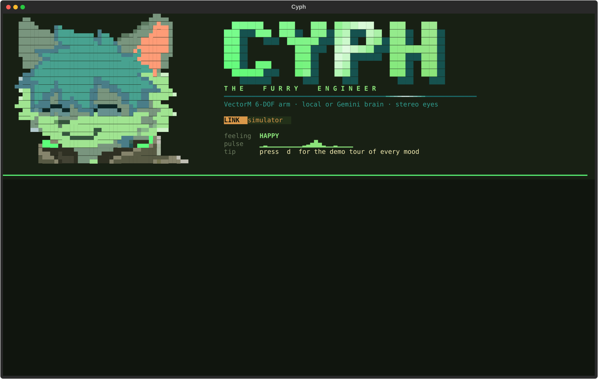
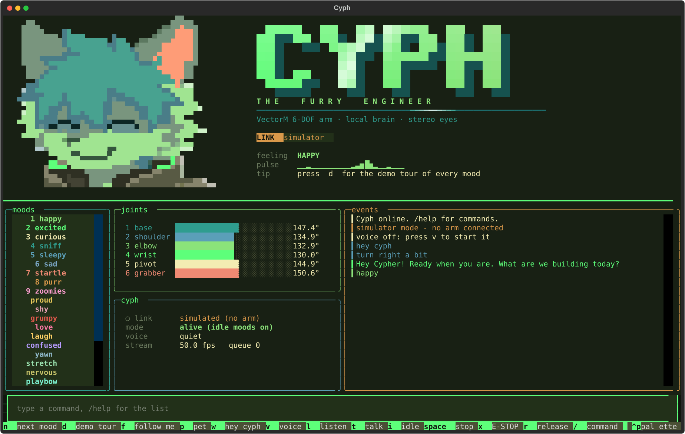
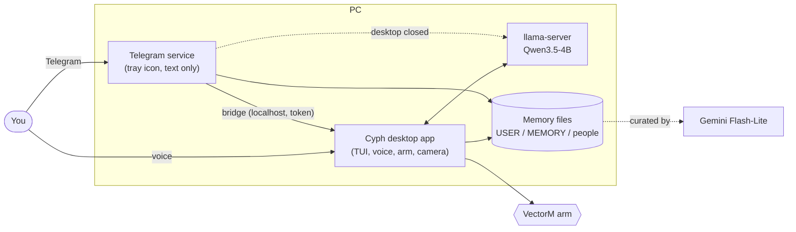

<div align="center">


# Cyph — the Furry Engineer

**A furry robot co-engineer that lives in your terminal, talks, remembers you, and moves a real 6-joint arm.**

<sub>Python · Textual TUI · local Qwen or Gemini brain · Telegram · long-term memory</sub>



</div>

---

## What it is

Cyph is a personal assistant with a body. The body is the **VectorM** arm (an STM32, six joints, a stereo camera on the
arm), and Cyph's face is drawn live in the terminal: it blinks, looks at you, and shows moods. You can talk to Cyph by
voice, type to it, or message it on Telegram from your phone.

The real interface (this one is the simulator, so no arm is needed to try it):

<div align="center">

</div>

## What works today

| | |
|---|---|
| **Body** | A daemon owns the arm: mood, idle "alive" motion and task moves layered together, joint limits, a speed guard, e-stop and reconnect. A simulator runs the same code with no hardware. |
| **Two brains** | `--brain local`: Qwen3.5-4B through llama-server on your GPU, fully offline apart from speech-to-text. `--brain gemini`: the Gemini Live API. |
| **Voice** | Silero VAD, streaming Cartesia Ink-2 speech-to-text (local Whisper as the fallback), Supertonic text-to-speech, barge-in so you can interrupt it. |
| **Arm by words** | The model writes tags like `[turn right 40]` or `[grip close]` in its reply. They run in order and are never spoken. |
| **Memory** | Capped Markdown files about you, your own notes and the people in your life, plus daily notes. A background curator (Gemini Flash-Lite) updates them with small add / replace / remove edits, and every edit is logged. |
| **Telegram** | Chat with Cyph from your phone. When the desktop app is open the message goes to that live session, arm included. When it is closed, a background service answers with the same memory. |
| **Background mode** | A tray icon starts the Telegram service, with "Turn off" from the tray (it saves memory first). |
| **Sense of time** | Every request carries the current date and time in Singapore time, and how long since your last message. |

## How it fits together



## Run it

Needs Python 3.13 on Windows. The arm host library (`arm_client`, `expressions`) comes from the
**VectorM** firmware project and is expected at `../vectorm-arm/host`, next to this folder.

```bash
pip install -r requirements.txt
python -m cyph --sim                          # simulator, no arm needed
python -m cyph --port COM15                   # the real arm
python -m cyph --brain local --port COM15     # local brain + voice
python -m cyph telegram                       # the Telegram service on its own
python -m cyph memory                         # show what Cyph remembers
```

Keys live in the environment or an untracked `cyph/.env`, never in the code:

```
GEMINI_API_KEY=...        # memory curator, and the Gemini brain
CARTESIA_API_KEY=...      # speech-to-text (falls back to local Whisper without it)
TELEGRAM_BOT_TOKEN=...    # from @BotFather
```

On Windows, `launch_cyph.ps1` opens Cyph in a Windows Terminal window at the top right of the screen,
and `launch_background.vbs` starts background mode (tray icon plus the Telegram service).

### Hotkeys and commands

`v` voice · `1`–`9` moods · `p` pet · `w` "hey cyph" · `l` listen · `t` talk · `i` idle · `space` stop ·
`x` E-STOP · `r` release · `/` type a command · `q` quit.
In the command line: a mood name, `/memory`, `/forget <words>`, `/ambient on|off`, `/help`.

## Privacy and safety

- **Your memory stays on your machine.** `data/` (memory, transcripts, logs) and `.env` are git-ignored.
- **Telegram is owner-only.** The first run prints a one-time pairing code; only that account is ever answered,
  and message text is never written to the log.
- **The desktop bridge listens on `127.0.0.1` only** and needs a random token.
- **Secrets are never stored in memory.** Entries that look like keys or tokens are rejected.
- **Honest limits.** Telegram chats are not end-to-end encrypted. The arm can hurt things: use the e-stop.

## Tests

```bash
for t in tests/test_*.py; do python $t; done
```

Hardware, the real network and the real model are faked in the tests, so passing them says nothing about the
arm or Cartesia/Telegram themselves.

## Roadmap

Planned, not built yet: a 24/7 server as the single owner of memory and uploads; routing hard jobs to a stronger
Gemini model; images over Telegram; file and task tools with approval; a quick-add schedule in Telegram with
morning briefs and deadline nudges; a study mode that explains your code in its own window.
