<div align="center">


# Cyph — the Furry Engineer

**A furry robot co-engineer that lives on your desktop and your phone, plans your day with you, remembers you, talks, and moves a real 6-joint arm.**

<sub>Python server · Tauri 2 + React app (Windows and Android) · Gemini brain · Telegram · long-term memory · VectorM arm</sub>

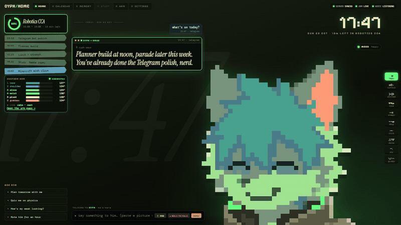

<sub>The face is drawn live from a pixel rig (blinks, ear twitches, a talking mouth). Moods above are the real app, driven from its mood list.</sub>

</div>

> **About the pictures.** Screens and GIFs in this README are the real app UI, captured from the running code, but they
> show **sample data** (a mock server with made-up plans and replies), not my own calendar or chats. The one real-phone
> picture is the widget strip crop (`phone-widget-strip-real.png`). Design mockups are labelled as mockups.

---

## Contents

[What it is](#what-it-is) · [The desktop app](#the-desktop-app) · [The phone app](#the-phone-app) · [Widgets](#home-screen-widgets) ·
[Notifications](#notifications) · [The arm](#the-arm) · [Telegram, memory, voice](#telegram-memory-and-voice) ·
[How it fits together](#how-it-fits-together) · [Run it](#run-it) · [Privacy](#privacy-and-safety) · [Honest status](#honest-status) · [Roadmap](#roadmap)

## What it is

Cyph is a personal co-engineer with a body. It started as a terminal pet for a robot arm and has grown into a small
system:

- a **24/7 server** (the brain, the planner, the memory) on a home machine,
- a **desktop app** and a **phone app** (one React UI, wrapped with Tauri) that talk to it over pinned TLS,
- **home-screen widgets and notifications** on Android that work even when the app is closed,
- a **Telegram** bot for when you are away from both,
- and the **VectorM arm** (an STM32, six joints, a camera) that Cyph can move by words or by a job you give it.

The bottom-right corner of every screen belongs to Cyph, so nothing in the UI is ever placed under him.

## The desktop app

Six pages: **Home**, **Calendar**, **Memory**, **Study**, **Arm**, **Settings** (see [Study](#study)).

<div align="center">
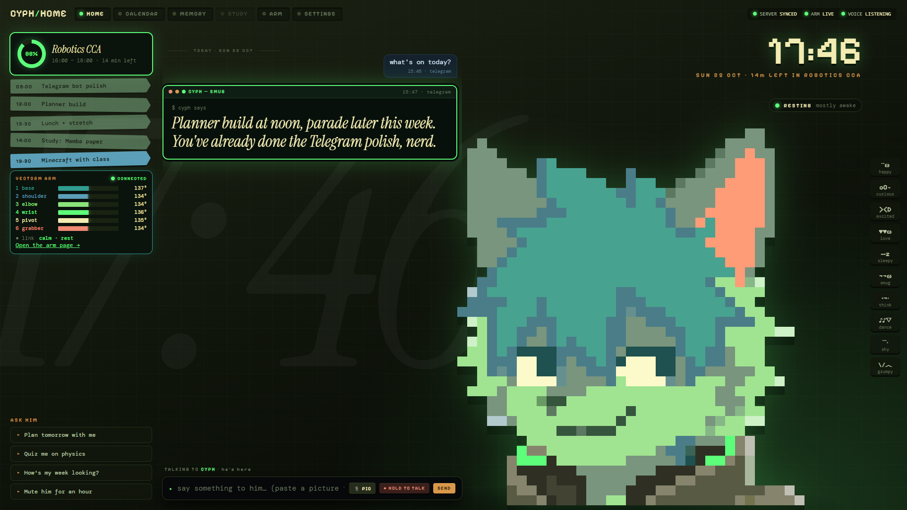
</div>

**Home** is a conversation. The latest reply is a big serif bubble, older ones fade into a log, Cyph's face reacts to
what he says, and the left rail shows what is happening now (a progress ring), the rest of today and the arm's joints.

<div align="center">
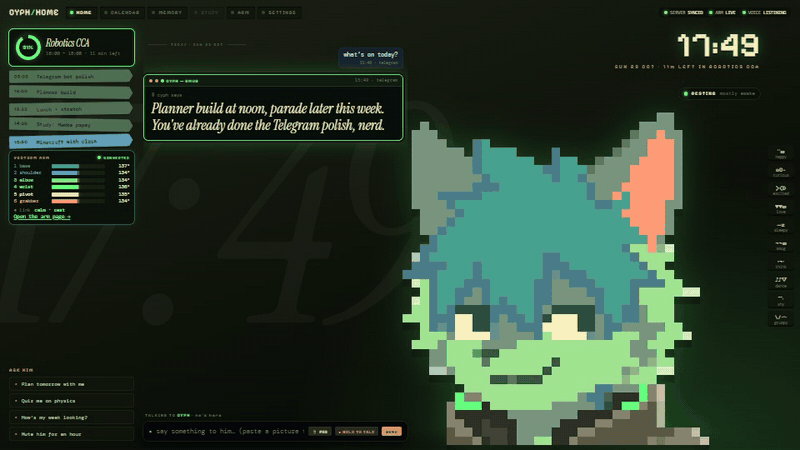
<br><sub>A reply arriving: streamed text, mood tag drives the face, mouth moves while he talks.</sub>
</div>

### Calendar

A real planner, not a picture of one: day / week / month / agenda, quick add by typing a sentence, recurring items, conflict detection (Cyph can be asked to sort a clash), notes per day that he reads, and a
"this day" rail.

<div align="center">
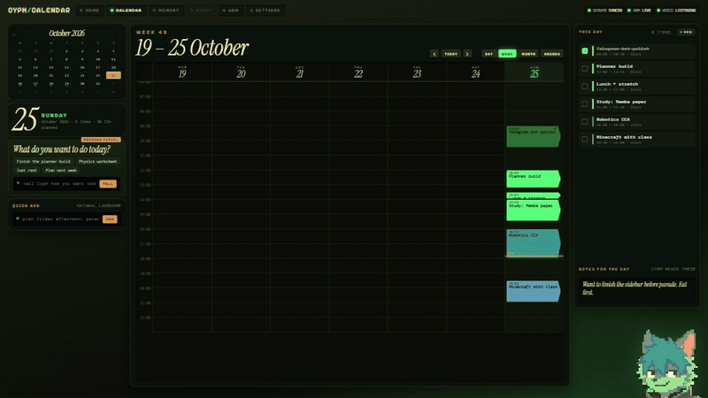
</div>

### Memory, Arm, Settings

<table>
<tr>
<td width="33%">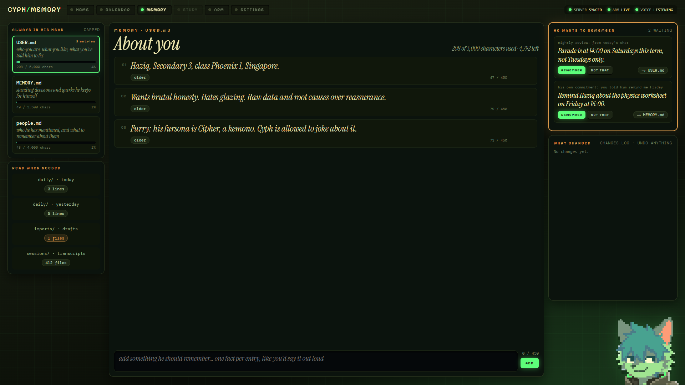</td>
<td width="33%">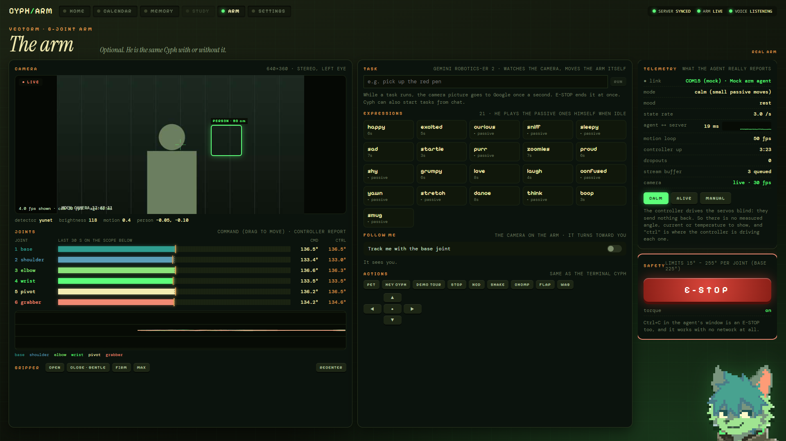</td>
<td width="33%">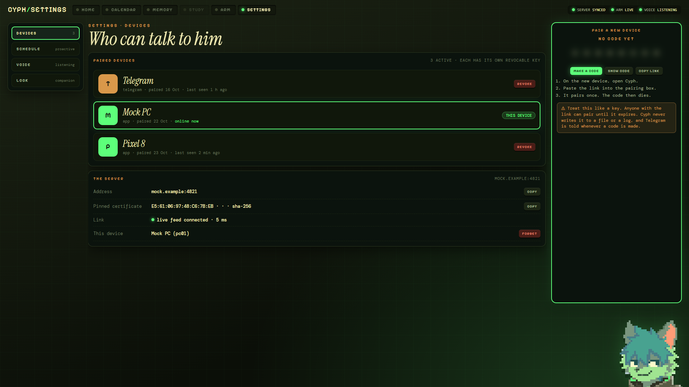</td>
</tr>
<tr>
<td><sub><b>Memory</b>: the capped Markdown files about you (profile, notes, people). You can add, edit and remove entries; the secret filter and size caps apply to you as they do to the model.</sub></td>
<td><sub><b>Arm</b>: live joints, the arm's camera, start / stop a job.</sub></td>
<td><sub><b>Settings</b>: pairing, paired devices (revoke a lost phone), mute.</sub></td>
</tr>
</table>

## The phone app

The same app on Android, with a layout built for a thumb: four tabs (**Cyph**, **Plan**, **Study**, **More**), a
big face in the corner of the chat, and a plan that fits the screen without scrolling the page.

<div align="center">
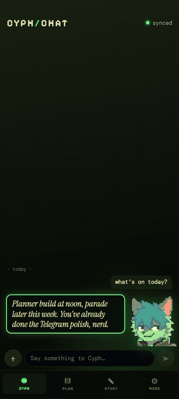
</div>

<table>
<tr>
<td align="center">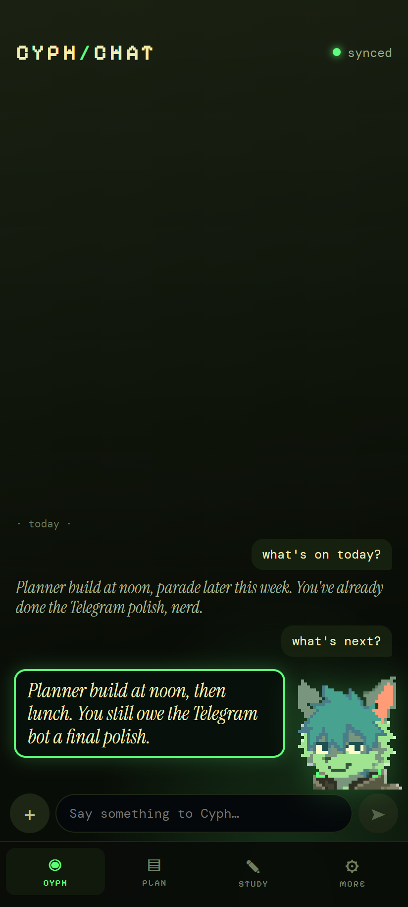<br><sub>Chat</sub></td>
<td align="center">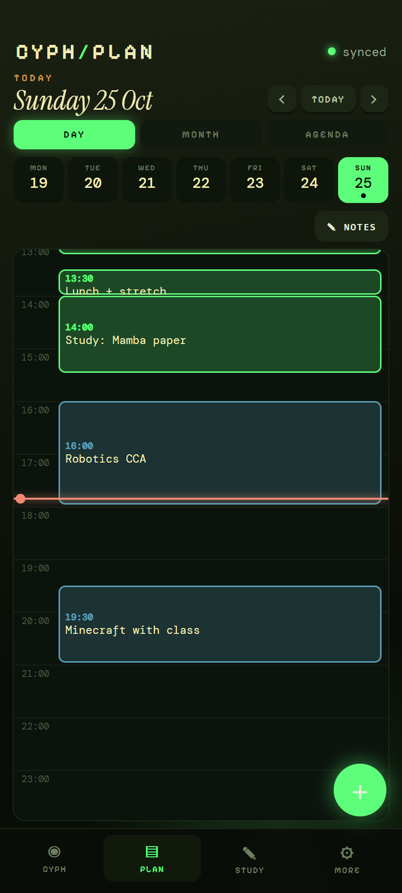<br><sub>Plan · Day</sub></td>
<td align="center">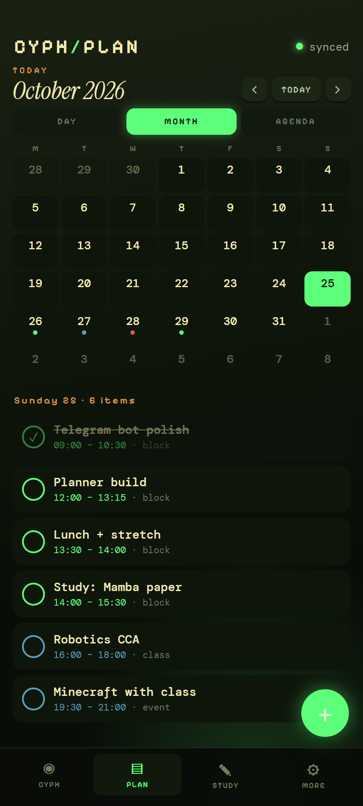<br><sub>Plan · Month</sub></td>
<td align="center">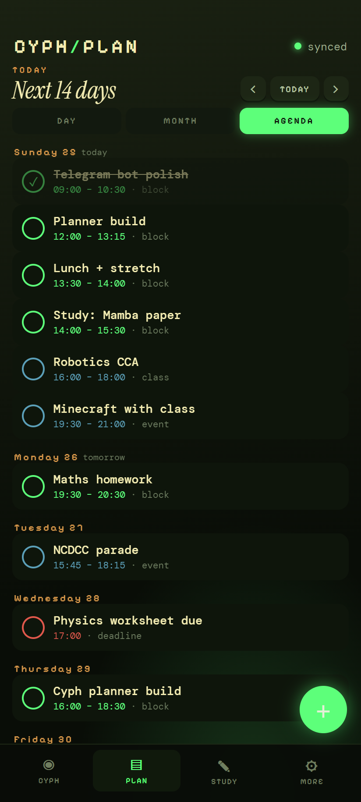<br><sub>Plan · Agenda</sub></td>
<td align="center">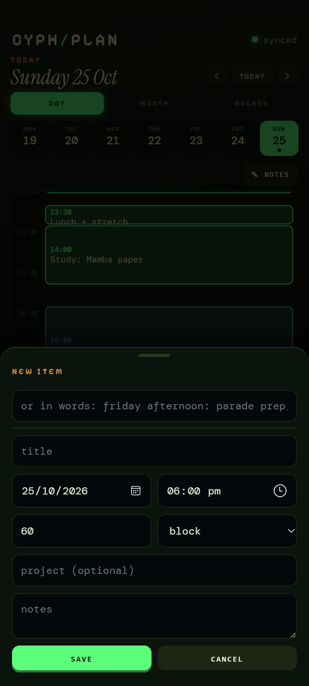<br><sub>Add item</sub></td>
</tr>
</table>

- **Chat** keeps the original look: your messages are small mono bubbles on the right, his older replies are plain
  italic serif lines in the log, and his newest reply sits in a green speech bubble next to his face (the first
  picture above). The link to home is watched: if it goes quiet for a minute, or the phone wakes up or changes network,
  the app reconnects by itself, and a message echoed back from the server never shows twice.
- **Pairing**: paste the one-time link (or use the paste button). The link carries the server address, the certificate
  fingerprint to pin and a code that works once for 10 minutes.
- **Plan** has Day, Month and Agenda views, a lane per kind of item, a day-notes sheet Cyph reads, and quick add.
- **More** has connection status, the notification switches, the "reply when the app is closed" toggle, mute and unpair.

## Home-screen widgets

Four native Android widgets (not a webview), all in the app's dark panel look. A widget is a picture the launcher
redraws, so the face in it is a crisp still of the current mood, not an animation. The outline colour is the state:
green on schedule, amber for what is next, teal while the arm works, grey when the server cannot be reached.

The pictures below are renders of the **design** for each variant (the strip is my real home screen). The "Built"
column says what is actually on the phone today.

| Widget | Picture | Shows | Built |
|---|---|---|---|
| **4×2 · Now** | 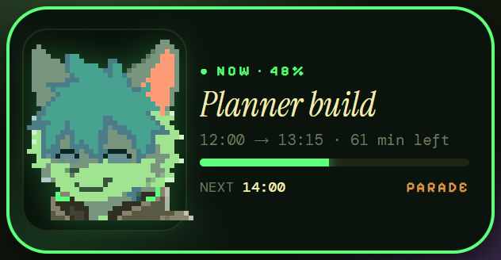 | The current block, a progress bar, time left, what is next. Falls back to **Next** (amber) between blocks. | Yes |
| **4×2 · Arm task** | 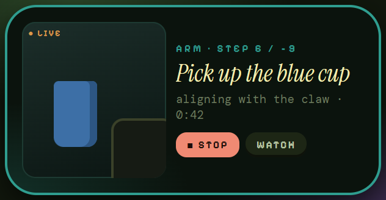 | The arm job and its step, teal outline. | Partly: the goal and step as text; the live camera view and STOP / WATCH buttons are design only. |
| **4×2 · No link** | 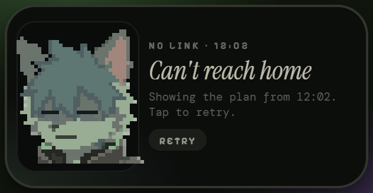 | Sleepy, desaturated; the last known plan with its time. Never blank. | Yes (no RETRY button; tap opens the app). |
| **4×2 · Nudge** | 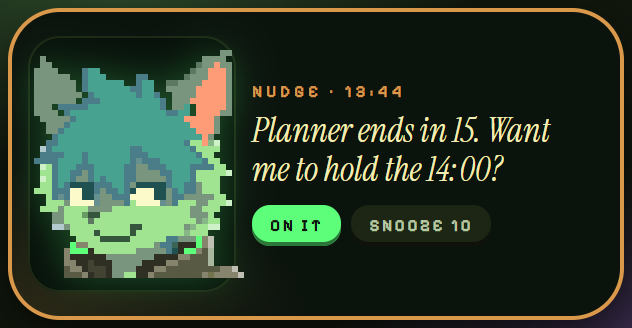 | "Block ends in 15, want me to hold the next one?" with ON IT / SNOOZE chips. | Design only (nudges are notifications today). |
| **4×2 · Today** | 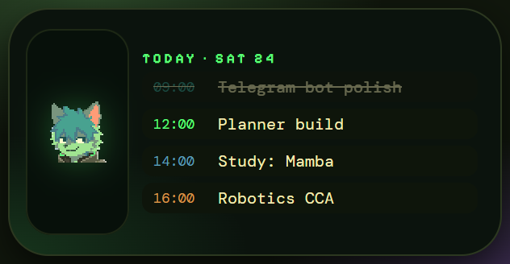 | The next four blocks, finished ones struck through. | Design only. |
| **2×2 · Face** | 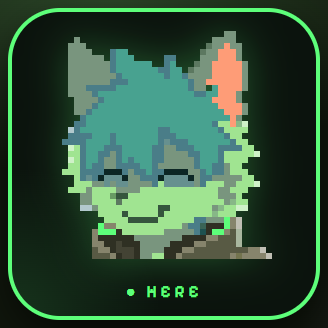 | Just him; the mood follows the day (sleepy late, happy after a finished block). Tap opens the app. | Yes |
| **2×2 · Next up** | 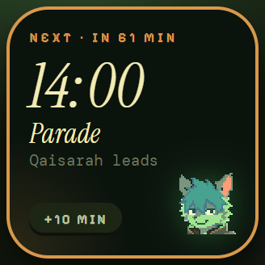 | The next block as a big clock time, small face in the corner (the bottom-right is his). | Yes (no +10 MIN chip). |
| **2×2 · Now ring** | 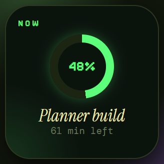 | Time left as a ring, no face. | Design only. |
| **2×2 · Study due** | 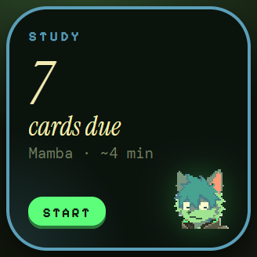 | Cards due and a START chip. | Design only (Study is not built). |
| **2×2 · Talk** | 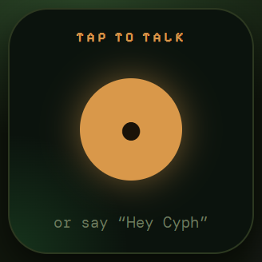 | A push-to-talk button. | Design only (no phone voice yet). |
| **2×2 · Muted** | 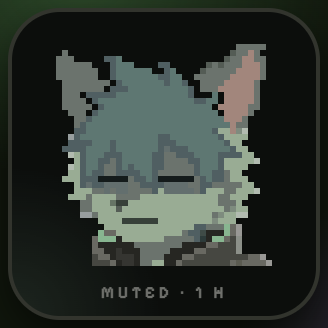 | Sleepy face, no nudges until the mute ends. | Design only. |
| **2×1 · Strip** | 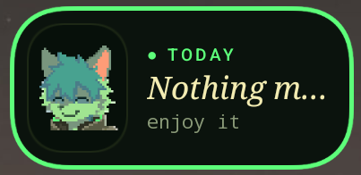 | A horizontal one-line strip: face plus the single most useful line. Resizable. | Yes. **Real photo**, cropped from my home screen. |


### Silly widgets (interactive, animated)

Eight more, built to be played with, and the first widgets that **do things without opening the app**: a tap is a
broadcast to the widget itself. They share one design rule: **the glowing edge is the readout**. A bright arc runs
clockwise from the top centre (progress, fullness, battery, nap time) and sweeps round when something happens. The
middle holds one hero (his face, a ball, a number), under it one line of text, and the whole widget is the tap target.
Idle motion (he blinks, a prompt cursor blinks) is a `ViewFlipper` the launcher animates itself; a reaction is a short
burst of partial updates. Everything works with no link to home. Written for HyperOS 3 (Android 16 base).

| Widget | Size | Tap | The edge shows |
|---|---|---|---|
| **Boop** | 2×2 | Boop his snoot. He purrs; boop fast and he giggles, then gets grumpy. | Progress to the next 50 boops. |
| **Snack Bowl** | 2×2 | Feed him (crunch animation). | The bowl: drains over 8 hours, green, amber, then coral. |
| **Cyph-Ball** | 2×2 | Shake. The ball wobbles and he types out advice you should not take. | Sweeps round while it shakes. |
| **Coin & Dice** | 2×2 | Tap the 🪙 half or the 🎲 half. It spins, slows down, and he judges the result. | Sweeps round while it spins. |
| **Nap Timer** | 2×2 | Tap the number to change 10 / 20 / 45, tap START. Tap again to wake. | How much of the nap is done. |
| **Excuse Generator** | 4×2 | Tap for a ridiculous excuse for the block you are on. | Sweeps round while it rolls. |
| **Look Busy** | 4×2 | Fake build logs scroll for a few seconds, then BUILD SUCCESSFUL (nobody checked). | Build progress. |
| **Existential Battery** | 2×1 | Your real battery as his feelings. Tap to poke him. | The battery level. |

The old **Face** widget now blinks on a loop, and the **4×2 Now** widget has a live countdown that ticks without
redrawing. Face frames for all 27 moods (and blink frames) come from `python tools_bake_widget_frames.py`.

**Getting the APK without a PC build:** the `Android APK` GitHub Actions workflow builds the debug APK. Open the
repo's **Actions** tab, pick the latest run and download the `cyph-debug-apk` artifact.

<details>
<summary><b>The same widgets on a home screen</b> (design mockup)</summary>
<br>
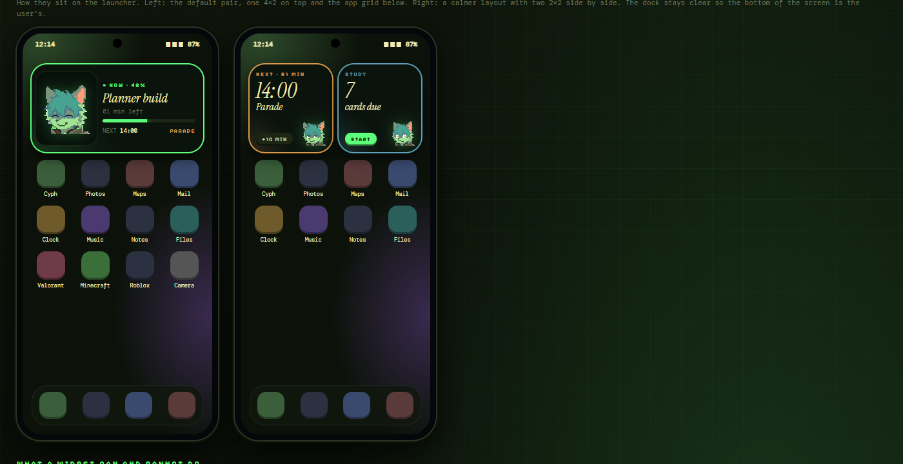
</details>

## Notifications

Cyph's notifications are small cards in the same look, with his face as the avatar. He speaks on a schedule, not at
random. Each kind is its own Android channel, so you can silence one (say Study) without touching the others.

| Kind | Card | When | Importance |
|---|---|---|---|
| **Reply** | 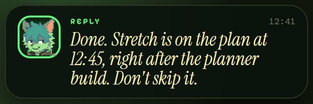 | He answered you while the app was closed. The card shows the whole answer and has an inline **Reply** box (the box is only in the real notification, not this picture). | High |
| **Nudge** | 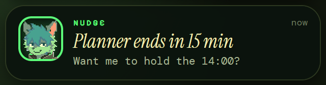 | A long block is about to end and something follows soon ("hold the next one?"). **SNOOZE 10** / **OPEN** chips. | High |
| **Reminder** | 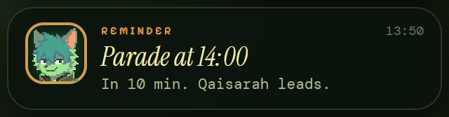 | 10 minutes before anything with a time. **SNOOZE 10** / **OPEN**. Exact alarms, so they ring even if the app is dead. | High |
| **Arm** | 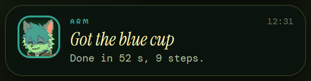 | An arm task finished or failed. | Default |
| **Study** | 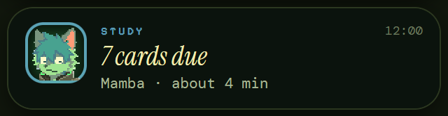 | Cards due. Today the evening Telegram nudge reports them; the Android notification is not wired yet. | Default |
| **Alert** | 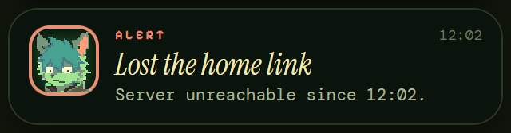 | The link to the server has been lost for 90 seconds. | High |
| **Quiet** | 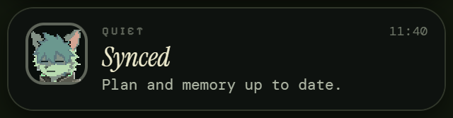 | Low-key, shade only, no sound. | Low |

<sub>Pictures are renders of the card design (the real card is the same layout, drawn by Android from a custom view).</sub>

**Replies when the app is closed.** A small foreground service keeps a pinned-TLS connection to the server, so when
Cyph answers a message you sent from your phone, you get the card even if the app is swiped away. Android requires a
permanent line for any such service ("Listening for replies"); it is its own channel and **More → Notifications →
Hide the listening line** takes you to the switch to hide it. Alarms and the service are restored after a reboot.

<details>
<summary><b>Notifications in use (design mockup)</b>: lock screen, heads-up, shade, ongoing arm task</summary>
<br>
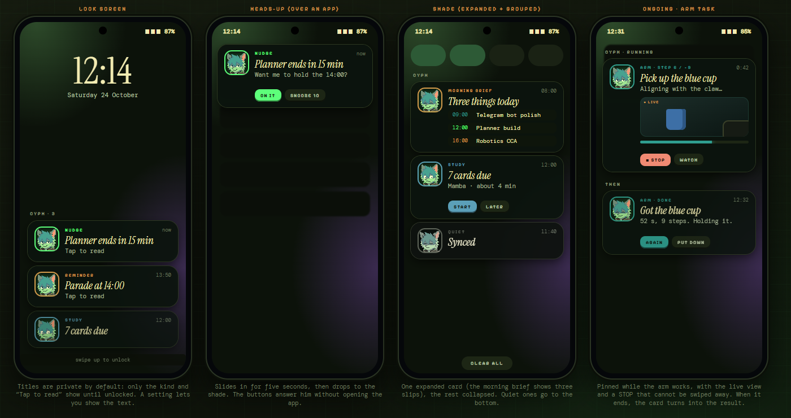
</details>

## The arm

The body is the **VectorM** arm: an STM32, six joints, a camera. A daemon owns the serial port and layers motion: an
always-on "alive" layer (breathing, glances) under the mood layer (happy, sad, curious…) under purposeful task moves.
Joint limits, a speed guard, an e-stop and reconnect protect it. A simulator runs the same code with no hardware.

- **By words**: the model writes tags like `[turn right 40]` or `[grip close]` in its reply. They run in order and are
  never spoken.
- **By job**: `python -m cyph.arm_agent` runs `arm_brain.py`, which streams the camera to Gemini Robotics-ER 2
  (Live API) and executes its tool calls on the body. Start a job from the Arm page or say it ("pick up the red pen").
  The PC's arm agent connects out to the server, so the server never needs to reach into your network.
- Moods and idle motion play around wherever the arm currently is, instead of snapping back to centre (`/center`).

> **Footage:** there is no arm video in this README yet. Add a short clip as `docs/media/arm-demo.gif` and link it here
> (see the commented line in the README source). I did not film the arm, so I have not invented one.

<!--  -->

## Telegram, memory and voice

| | |
|---|---|
| **Telegram** | Owner-only chat from your phone. Photos, PDFs and text files work; "math test fri 9am" files itself on the schedule with an Undo button; `/today`, `/week`, `/summary`, `/gemini`, `/local`, `/auto`, `/nudges off`. |
| **Memory** | Capped Markdown files about you, your notes and the people in your life, plus daily notes. A background curator makes small add / replace / remove edits, every edit is logged, and secrets are filtered out. |
| **Nightly review** | After 23:00 (when you are quiet) Gemini Flash-Lite promotes lasting habits from the last three days, fixes stale entries and archives old daily notes. |
| **Long chats keep their thread** | Older messages fold into a short running summary that rides along with every turn. |
| **Speaks first, sparingly** | Morning brief, a heads-up before something starts, an evening nudge for tests and deadlines; quiet hours, none in school time, and they pause if you ignore two in a row. |
| **Voice** | Silero VAD, streaming Cartesia speech-to-text (local Whisper fallback), Supertonic text-to-speech, barge-in, and a "Hey Cyph" wake word ([setup](docs/wake-word.md)). |
| **Files, with approval** | Gemini can list, read and search folders you allow, and write notes only after you tap Allow. No shell; `.env` and keys are unreadable; text inside a file is data, never instructions. |
| **Hard questions go to Gemini** | Chat and arm commands run on the local Qwen model; explanations, code, homework and long messages route to Gemini by simple rules, with a daily cap and a silent fallback. |

## How it fits together

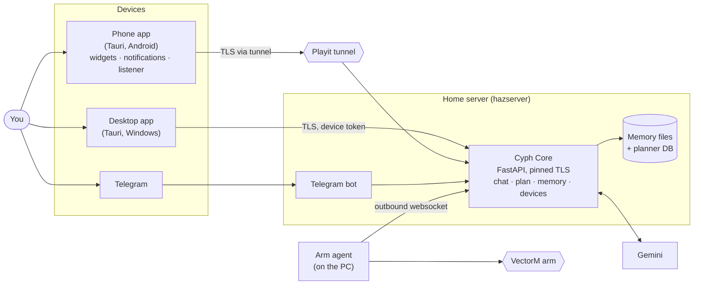

- **Core API** ([docs/core-api.md](docs/core-api.md)): HTTPS with a self-signed certificate that clients **pin by
  SHA-256**, per-device revocable tokens, rate limit and lockout, 64 KiB body cap. A `/chat` WebSocket streams the
  reply; `/events` relays a turn to the other devices (that is how the phone sees a reply to a message sent elsewhere).
- **Rust owns the network.** The webview never opens a socket, because a webview cannot pin a certificate.
- **Offline**: each device caches the day and memory read-only; edits made offline queue and replay.
- **The phone's native side** (Kotlin) is separate from the webview: widgets, exact-alarm reminders, notifications and the
  listener service keep working when the web UI is asleep.

## Run it

**Server and arm (Python 3.13)**

```bash
pip install -r requirements.txt            # PC; the server uses requirements-server.txt
python -m cyph.core                        # Cyph Core API
python -m cyph telegram                    # the Telegram bot on its own
python -m cyph.arm_agent                   # the arm agent (needs the VectorM host library at ../vectorm-arm/host)
python deploy/deploy_server.py pair        # prints a one-time pair link (valid 10 minutes). Treat it as a secret.
```

Keys live in the environment or an untracked `cyph/.env`, never in code:

```
GEMINI_API_KEY=...        # brain, memory curator, arm brain
CARTESIA_API_KEY=...      # speech-to-text (falls back to local Whisper)
TELEGRAM_BOT_TOKEN=...    # from @BotFather
```

**The app** (in `app/`; see [docs/app-dev.md](docs/app-dev.md))

```bash
pnpm install
pnpm dev                       # UI alone in a browser; add ?mock for an in-memory fake server (no Tauri, no server)
pnpm tauri dev                 # the desktop app
pnpm tauri android build --debug --apk --target aarch64
```

The Android build needs the Android SDK/NDK and, on Windows, Developer Mode (a symlink step); my notes on the
workarounds are in `docs/app-dev.md`. The server `deploy/deploy_server.py` has `code|venv|check|service|migrate|status|logs|stop`.

**Tests**

```bash
for t in tests/test_*.py; do python $t; done      # Python (hardware, network and models are faked)
cd app && pnpm test && pnpm exec tsc --noEmit     # frontend
cd app/src-tauri && cargo test                    # Rust (starts local TLS servers)
```

Passing the fakes says nothing about the arm, Cartesia or Telegram themselves.

## Privacy and safety

- **Your data stays on your machines.** `data/` (memory, transcripts, logs) and `.env` are git-ignored.
- **Pinned TLS**: a wrong certificate is refused at the handshake. Tokens are per device and revocable.
- **Telegram is owner-only**; message text is never written to logs.
- **Secrets are never stored in memory**; entries that look like keys or tokens are rejected.
- **Widgets and notifications never show chat text on the lock screen or in widgets**, only plan titles and times
  (the one exception is a Reply card, which is the answer you were waiting for).
- **The arm can hurt things.** Use the e-stop.

## Honest status

What is real, and what is not yet:

| Area | State |
|---|---|
| Core server, planner, memory, Telegram, sync | Working, used daily. |
| Desktop app (Home, Calendar, Memory, Study, Arm, Settings) | Working. Study is built and tested against a fake model and the mock server; it has not yet run against the real Gemini API. |
| Phone app (Chat, Plan, More) | Working on my Xiaomi 13T (HyperOS 3). Study tab is built (review, tutor, add, cards, pen) but untested on the phone. |
| Widgets (4×2, 2×2, 2×1) and notifications | Working on the phone. Widgets are static pictures; several designed variants are not built. |
| Replies when the app is closed | Working via a foreground service. **Xiaomi/HyperOS may kill it** unless the app has Autostart on and battery set to "No restrictions" (the app links you to those pages). |
| Push notifications (FCM) | **Not built.** The phone keeps its own connection instead. |
| Voice on the phone, QR pairing | Not built. |
| Arm | Works on the real arm; there is no footage in this repo yet. |
| Build | Debug APK only (large, unsigned; antivirus may flag each reinstall). The device token is stored unencrypted in the app's private folder (follow-up: OS keystore). |

## Study

Seven subjects (Math, Chemistry, Physics, Amath, English, SS, Geog). Everything lives in the core server
(`cyph/core/study.py` and the session engine `cyph/core/session.py`, routes in `study_api.py`, SQLite under `data/core/study/`),
so the PC, phone and iPad see the same data. Design mockups: `docs/mockups/study-v2.html`.

Study is built around one question: **what do I do now?** Four screens, the same on phone, PC and iPad:

- **NOW**: Cyph picks the session (cards due, weak topics, a test inside a day, a comeback after 5+ days away) and you press START.
  "Just 3 cards" is always offered. Steps: cards (two buttons), a 3-minute lesson for new or failing topics, questions, homework.
  Phone questions are tap-to-answer or one number; PC and iPad take written working or a photo. English and SS get answer plans and
  self-ticked checklists (Cyph does not mark writing). A session started on one device can be continued on the other.
- **Questions** come from your own worksheets first (real question, marks and answer key extracted at import, the diagram cropped from the
  PDF page). Cyph-made questions are labelled and weighted less. Marking is per point; the final number is checked in code, not by the
  model, and Cyph says "not sure" when it is. **I think I'm right** re-marks at once and can only raise the mark. **Bad question** bins
  it and teaches Cyph a rule for that topic.
- **DEBRIEF**: when you get home, say one thing you learned (typed is enough). Cyph checks it against your notes and makes cards from the gaps.
- **INBOX**: throw in a PDF, photo or text. It is kept straight away, filed by subject and topic, with UNDO and "wrong subject".
- **LIBRARY**: subjects and topics with strength in words (not started, weak, okay, solid), each topic's notes, cards, questions and what
  Cyph has learned about you there. The older tools (notes, tutor, cards, practice, notebooks, boards) are still beside it.
- **Reminders** are a nudge, never a lock: an evening "Home yet?" message (`study_nudge`, default 16:30) and a line in chat. Tests and
  homework are told to Cyph in chat. Teacher marks outweigh Cyph's. No backlog count and no streak are shown.
- Maths and chemistry render with KaTeX and mhchem.

Models are set with `CYPH_STUDY_MODEL` and `CYPH_EMBED_MODEL` (the defaults are unverified; set them to models your key can use).
Not done yet: the Android notification for the study reminder, voice debrief, syllabus topics for each subject (`POST /study/syllabus`
is ready; it needs the exam type and syllabus codes).

### iPad

Build the app once (`cd app && pnpm build`). The core server then serves it: open `https://<pc-address>:<port>/` in Safari, pair
with the code, and add it to the Home Screen. Safari needs to trust the server's self-signed certificate: open
`https://<pc-address>:<port>/cert.pem`, install the profile, then enable it under Settings, General, About, Certificate Trust Settings.
Away from home, put the PC and iPad on Tailscale. Pencil input uses pointer events with palm rejection; strokes are queued
offline and sent when the connection returns.

An iPad gets the PC layout with bigger tap targets (it is detected as an iPad even when Safari reports a Mac; add `?ipad` to force it
when testing). A written question shows the diagram beside a Pencil pad: **CHECK MY ANSWER** sends a picture of your page for marking,
**TYPE INSTEAD** swaps to a keyboard. The weekly paragraph for English and SS is the question, the pad, and a checklist you tick
yourself. If the page is reached through a tunnel such as playit, the certificate step above only applies when the address you open
is served with the server's own certificate.

## Roadmap

Study on real Gemini models and real hardware (Apple Pencil, Safari certificate trust), phone voice and QR pairing, push via FCM,
a signed release build, an encrypted token store, and the remaining widget variants.

<details>
<summary>The old terminal UI (retired, still runnable with <code>python -m cyph tui</code>)</summary>
<br>
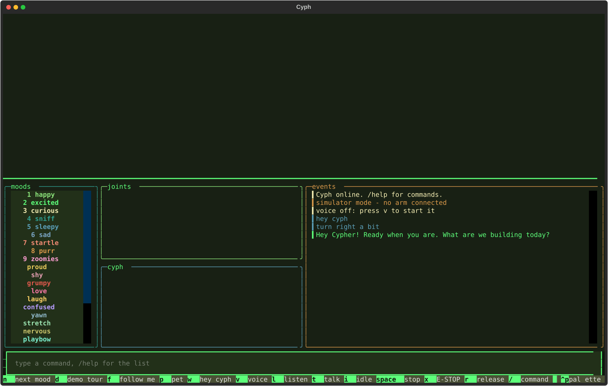
</details>
