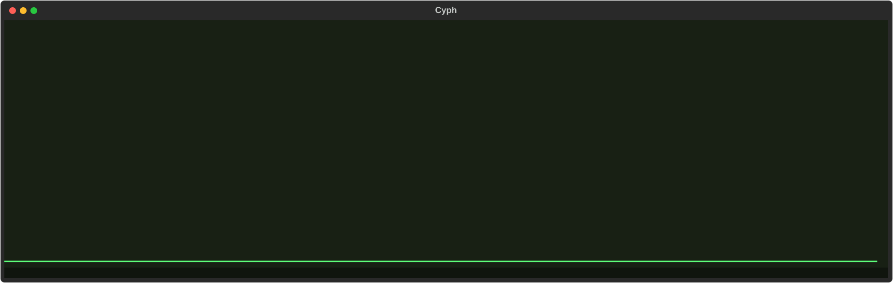
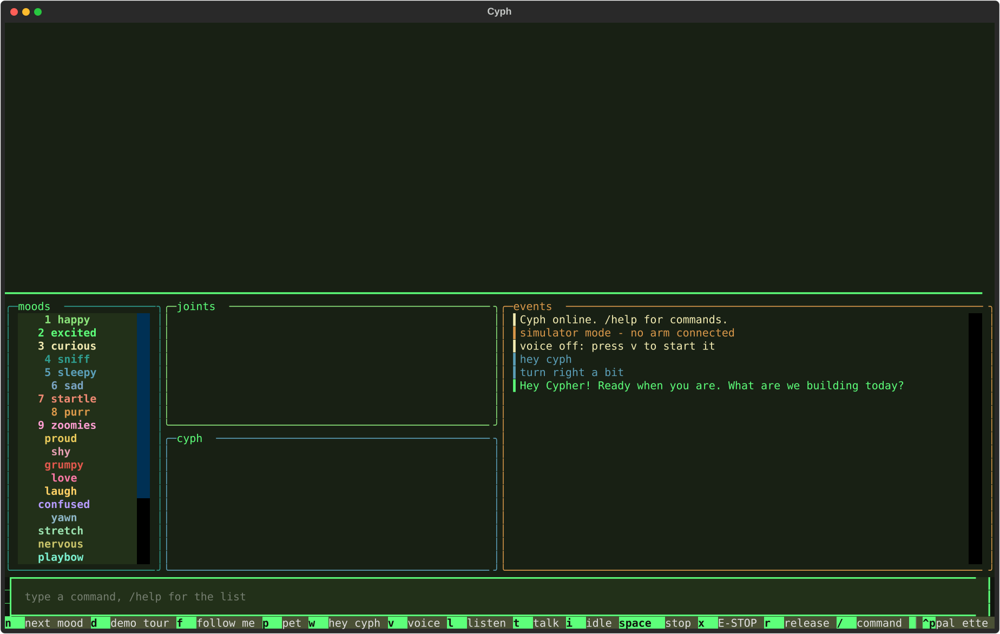

<div align="center">


# Cyph — the Furry Engineer

**A furry robot co-engineer that lives in your terminal, talks, remembers you, and moves a real 6-joint arm.**

<sub>Python · Textual TUI · local Qwen brain · Telegram · long-term memory</sub>



</div>

---

## What it is

Cyph is a personal assistant with a body. The body is the **VectorM** arm (an STM32, six joints, a stereo camera on the
arm), and Cyph's face is drawn live in the terminal: it blinks, looks at you, and shows moods. You can talk to Cyph by
voice, type to it, or message it on Telegram from your phone.

The real interface (this one is the simulator, so no arm is needed to try it):

<div align="center">

</div>

## What works today

| | |
|---|---|
| **Body** | A daemon owns the arm: mood, idle "alive" motion and task moves layered together, joint limits, a speed guard, e-stop and reconnect. A simulator runs the same code with no hardware. |
| **Local brain** | Qwen3.5-4B through llama-server on your GPU (Vulkan). The conversation never leaves the PC; only speech-to-text uses the network, and Cyph falls back to local Whisper if that is down. Gemini is used only in the background, to curate memory. |
| **Voice** | Silero VAD, streaming Cartesia Ink-2 speech-to-text (local Whisper as the fallback), Supertonic text-to-speech, barge-in so you can interrupt it. |
| **Arm by words** | The model writes tags like `[turn right 40]` or `[grip close]` in its reply. They run in order and are never spoken. |
| **Memory** | Capped Markdown files about you, your own notes and the people in your life, plus daily notes. A background curator (Gemini Flash-Lite) updates them with small add / replace / remove edits, and every edit is logged. |
| **Telegram** | Chat with Cyph from your phone. When the desktop app is open the message goes to that live session, arm included. When it is closed, a background service answers with the same memory. |
| **Background mode** | A tray icon starts the Telegram service, with "Turn off" from the tray (it saves memory first). |
| **Hard questions go to Gemini** | The local model answers chat and arm commands. Explanations, code, homework, long messages, files and photos are routed to Gemini 3.8 Flash by simple rules (no extra delay), with a daily call cap and a silent fall back to the local model if Gemini fails. Switches are logged to `data/router.log` (reasons only, never your messages). |
| **You choose the model** | `/gemini`, `/local` and `/auto` (in the app and on Telegram) force Gemini 3.8 Flash, force the local Qwen, or let the router decide. The status panel shows which model answered last and why, and both models share one conversation, so switching never loses context. |
| **Files and notes (with approval)** | On Telegram, Gemini can list, read and search files in folders you allow (`/allow read <folder>`, `/folders`) and write notes after you tap **Allow**. Secrets (`.env`, keys, tokens) are never readable, there is no shell, and text inside a file is treated as data, never as instructions. |
| **Speaks first, sparingly** | A morning brief, a heads-up 30 minutes before something starts, and an evening nudge for tests and deadlines coming up. Quiet hours, no optional nudges during school, and they pause if you ignore two in a row. `/nudges off` stops them. |
| **Moods happen where the arm is** | After "turn left" or following you, moods and idle motion play around that pose instead of snapping back to the middle. `/center` brings it back. |
| **Photos and files on Telegram** | Send a photo, a PDF or a text file. Photos go to whichever brain is answering, and the live desktop session sees them too. Everything you send is kept in `data/user/inbox/`. File contents are treated as data, never as instructions. |
| **Schedule by texting** | Text "math test fri 9am" or "parade every tuesday 3pm" and Cyph files it, confirms the exact date with an Undo button, and asks one question if it is unclear. `/today`, `/tomorrow` and `/week` list it, and what is coming up is in every prompt. Times are Singapore time. |
| **Finds its own camera** | Windows renumbers cameras, so the arm's stereo camera is detected by its shape (very wide frames) and remembered, instead of trusting a fixed index. |
| **Sense of time** | Every request carries the current date and time in Singapore time, and how long since your last message. |

## How it fits together


## Run it

Needs Python 3.13 on Windows. The arm host library (`arm_client`, `expressions`) comes from the
**VectorM** firmware project and is expected at `../vectorm-arm/host`, next to this folder.

```bash
pip install -r requirements.txt
python -m cyph --sim --no-voice               # simulator only, no arm and no models
python -m cyph --sim                          # simulator with the local brain and voice
python -m cyph --port COM15                   # the real arm, local brain and voice
python -m cyph telegram                       # the Telegram service on its own
python -m cyph memory                         # show what Cyph remembers
```

Keys live in the environment or an untracked `cyph/.env`, never in the code:

```
GEMINI_API_KEY=...        # background memory curator (Gemini Flash-Lite)
CARTESIA_API_KEY=...      # speech-to-text (falls back to local Whisper without it)
TELEGRAM_BOT_TOKEN=...    # from @BotFather
```

On Windows, `launch_cyph.ps1` opens Cyph in a Windows Terminal window at the top right of the screen,
and `launch_background.vbs` starts background mode (tray icon plus the Telegram service).

### Hotkeys and commands

`v` voice · `1`–`9` moods · `p` pet · `w` "hey cyph" · `l` listen · `t` talk · `i` idle · `space` stop ·
`x` E-STOP · `r` release · `/` type a command · `q` quit.
In the command line: a mood name, `/memory`, `/forget <words>`, `/ambient on|off`, `/help`.

## Privacy and safety

- **Your memory stays on your machine.** `data/` (memory, transcripts, logs) and `.env` are git-ignored.
- **Telegram is owner-only.** The first run prints a one-time pairing code; only that account is ever answered,
  and message text is never written to the log.
- **The desktop bridge listens on `127.0.0.1` only** and needs a random token.
- **Secrets are never stored in memory.** Entries that look like keys or tokens are rejected.
- **Honest limits.** Telegram chats are not end-to-end encrypted. The arm can hurt things: use the e-stop.

## Tests

```bash
for t in tests/test_*.py; do python $t; done
```

Hardware, the real network and the real model are faked in the tests, so passing them says nothing about the
arm or Cartesia/Telegram themselves.

## Roadmap

Planned, not built yet: a 24/7 server as the single owner of memory, the schedule and uploads (so the PC and the
phone always agree); file and task tools for the stronger model, with approval buttons before anything is written
or run; proactive morning briefs, deadline nudges and study check-ins; a study mode that explains your code in its
own window.
